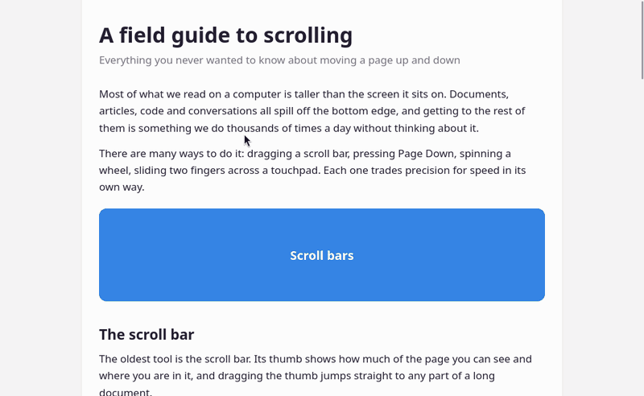
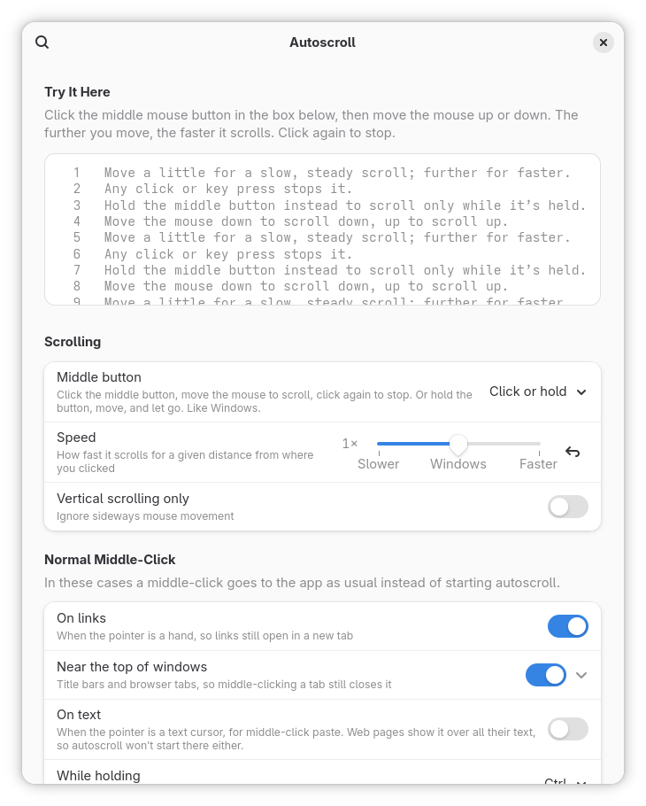

# Autoscroll

Middle-click autoscroll for GNOME, the way Windows does it, in every app.



- **Click the middle mouse button, then move the mouse.** The window scrolls that way, and the further you move from where you clicked, the faster it goes. Click again, or press any key, to stop.
- **Or hold the middle button down,** move, and let go when you're done.
- **It looks and feels like Windows 11:** a round marker stays where you clicked, the pointer turns into an arrow showing which way it's scrolling, and pages scroll exactly as fast as they do in Microsoft Edge and Google Chrome.
- **It works in every app:** browsers, Electron apps (VS Code, Discord, Spotify, Obsidian…), GTK and Qt apps, and Xwayland apps. They all scroll at the same speed.
- **Middle-click still works where it matters:** on links (to open them in a new tab), on browser tabs (to close them), in terminals (to paste), and in drawing, 3D, CAD, remote-desktop apps and games. Hold <kbd>Ctrl</kbd> for a normal middle-click anywhere.

On Linux the middle button pastes, and almost no app can autoscroll (Firefox can, with a setting turned on). Autoscroll adds it to GNOME Shell itself, so every app gets it, without changing anything in the apps.

<picture>
  <source media="(prefers-color-scheme: dark)" srcset="docs/preferences-dark.png">
  
</picture>

**If this is useful to you, please ⭐ [star the repo](https://github.com/Jire/autoscroll) and [follow @Jire on GitHub](https://github.com/Jire) for more free tools like this.**

## Install

Paste the command for your distro into a terminal. Don't use `sudo`: it installs into your home folder.

**Arch Linux, EndeavourOS, CachyOS, Manjaro**

```bash
curl -fsSL https://raw.githubusercontent.com/Jire/autoscroll/main/install.sh | bash
```

**Fedora**

```bash
curl -fsSL https://raw.githubusercontent.com/Jire/autoscroll/main/install.sh | bash
```

**Ubuntu and Ubuntu-based** (uses `wget`, which Ubuntu ships with by default)

```bash
wget -qO- https://raw.githubusercontent.com/Jire/autoscroll/main/install.sh | bash
```

Then **log out and back in**. GNOME only loads newly installed extensions at login (or see the next section to load it right away).

The installer downloads the latest release, installs it with `gnome-extensions`, turns it on, and tells you if anything else is needed. That's all: middle-click in any window and move the mouse.

### Load without logging out (Wayland)

GNOME's built-in Looking Glass console can load the extension into the running session:

1. Press <kbd>Alt</kbd>+<kbd>F2</kbd>, type `lg`, press <kbd>Enter</kbd>.
2. Paste this line into the prompt at the bottom and press <kbd>Enter</kbd>:

   ```js
   eval(new TextDecoder().decode(imports.gi.GLib.file_get_contents(imports.gi.GLib.get_user_data_dir() + '/autoscroll/hot-load.js')[1]))
   ```

3. Press <kbd>Esc</kbd>. A notification confirms it loaded.

This also works for reloading after an update. At your next normal login the regular installed copy loads as usual.

## Using it

| | |
| --- | --- |
| **Start** | Click the middle mouse button (press the scroll wheel) over whatever you want to scroll. A marker appears where you clicked. |
| **Scroll** | Move the mouse away from the marker. Within about 15 pixels of it nothing moves, so it's easy to pause; beyond that it scrolls towards the pointer, slowly at first and faster the further away you go. Diagonal works too. |
| **Stop** | Click any mouse button, press any key, or turn the scroll wheel. The click or key that stops it does nothing else, so you can't accidentally click a link. |
| **Hold instead** | Press and hold the middle button, move, and let go to stop. |
| **Normal middle-click** | Hold <kbd>Ctrl</kbd> while middle-clicking (to paste, for example). Links, browser tabs, title bars and the apps in the settings list always get a normal middle-click. |

## Settings

Open **Extensions** and click the gear next to Autoscroll, or run:

```bash
gnome-extensions prefs autoscroll@jire.github.io
```

If you don't have the Extensions app, install it with `sudo pacman -S gnome-extensions-app` (Arch), `sudo dnf install gnome-extensions-app` (Fedora) or `sudo apt install gnome-shell-extension-prefs` (Ubuntu).

| Setting | Default | What it does |
| --- | --- | --- |
| Middle button | Click or hold | **Click or hold** works like Windows. **Hold only** scrolls only while the button is held, so a quick middle-click still pastes, opens links and closes tabs. |
| Speed | 1× (Windows) | Slower or faster than Windows, for the same distance from the marker. |
| Vertical scrolling only | Off | Ignore sideways movement. |
| Normal middle-click on links | On | When the pointer is a hand (over a link or a button), the middle-click goes to the app, so links open in a new tab. |
| Normal middle-click near the top of windows | On, 48 px | Title bars, header bars and browser tab strips, so middle-clicking a tab still closes it. |
| Normal middle-click on text | Off | When the pointer is a text cursor, the middle-click goes to the app (to paste). Web pages show the text cursor over all of their text, so autoscroll won't start there either. |
| While holding | <kbd>Ctrl</kbd> | Hold this key while middle-clicking for a normal middle-click. |
| Apps without autoscroll | Terminals, drawing, 3D, CAD and remote-desktop apps, Steam games, Wine apps | These apps keep the middle button to themselves. Add or remove apps, or add a window class for anything that isn't listed. |

There's also a box at the top of the settings to try it out in.

## Update

Run the install command again.

## Uninstall

```bash
curl -fsSL https://raw.githubusercontent.com/Jire/autoscroll/main/install.sh | bash -s -- --uninstall
```

(On Ubuntu, swap the start for `wget -qO- …`.) This keeps your settings in case you reinstall. Use `--purge` instead of `--uninstall` to reset them too. You can also remove the extension from the **Extensions** app.

## Requirements

- **GNOME Shell 46 to 51, on Wayland.** Check yours with `gnome-shell --version`. That covers current Arch and its derivatives, Fedora 40 and newer, Ubuntu 24.04 LTS and newer (including 26.04 LTS) and Debian 13.
  - Developed on GNOME 51 (Arch Linux). Automated tests drive it with a virtual mouse in a headless GNOME Shell 51: end-to-end tests of every way to start and stop it (including that the clicks it handles never reach the app), and scroll-speed checks in GTK 4, GTK 3, Qt 5, Qt 6, Java, Firefox and Chromium windows, on both Wayland and Xwayland.
  - GNOME 46 to 50 handle input the same way, which was checked against their source code, but they haven't been tested yet. Please [open an issue](https://github.com/Jire/autoscroll/issues) if something doesn't work.
- **Not "GNOME on Xorg".** In an X11 session, apps get mouse clicks straight from the X server, so GNOME Shell can't turn them into autoscroll. Pick "GNOME" (not "GNOME on Xorg") on the login screen. GNOME 49 and later only have the Wayland session anyway.
- It's a GNOME Shell extension, so it doesn't work on KDE Plasma, Cinnamon (Linux Mint), COSMIC (Pop!_OS) or other desktops.

## How it works

Autoscroll runs inside GNOME Shell, which on Wayland is also the compositor that hands every mouse event to apps:

- **The middle-click never reaches the app.** GNOME Shell sees the click before the app does, and keeps it from the app (unless it's on a link, a tab, a title bar or in an app on the list, which get it as usual).
- **The app keeps scrolling what you clicked on.** Like Windows apps do while autoscrolling, the real mouse pointer is held in place at the marker, so the app keeps scrolling the part of the window you clicked. The pointer you see is drawn by Autoscroll and follows your hand; when autoscroll ends, the real pointer is put back where you'd expect.
- **Smooth, pixel-precise scrolling.** Every frame, Autoscroll sends the app a small touchpad-style scroll, at the speed Edge and Chrome autoscroll on Windows: nothing within 15 px of the marker, then faster the further away you go (about 200 px/s at 100 px, 900 px/s at 200 px, 2200 px/s at 300 px). It never sends the "finger lifted" signal that makes apps fling the page on, so it stops dead when you stop, like Windows.
- **The same speed in every app.** Toolkits turn the same scroll into very different distances (Chromium scrolls 4 times as far as GTK 4 for the same input), so Autoscroll works out which toolkit each window uses and adjusts for it. The adjustments were measured for Chromium/Electron, Firefox, GTK 3, GTK 4, Qt and Java.
- **Links are recognised by the pointer.** Apps turn the pointer into a hand over links, and Autoscroll recognises the hand from your cursor theme's images.

[AGENTS.md](AGENTS.md) explains it in detail, for contributors.

## Questions

**Firefox has its own autoscroll. Which one do I get?**
Autoscroll's: Firefox never sees the middle-click. They look and behave almost the same. If you'd rather use Firefox's (it's turned on under Settings → General → Browsing → "Use autoscrolling"), add Firefox to "Apps without autoscroll".

**How do I paste with the middle button now?**
Hold <kbd>Ctrl</kbd> while middle-clicking. Or turn on "Normal middle-click on text", or switch the middle button to "Hold only". Terminals are on the app list, so middle-click paste there works as before.

**A game or app needs the middle button.**
Add it to "Apps without autoscroll" in the settings (for games that aren't listed as apps, add their window class). Games that hide the mouse pointer, Steam games and Windows games under Wine or Proton are left alone already.

**It doesn't start somewhere, or starts where it shouldn't.**
See [Troubleshooting](#troubleshooting): the debug log says why for every middle-click.

## Troubleshooting

```bash
gnome-extensions info autoscroll@jire.github.io   # is it enabled? any errors?
journalctl --user -f -g autoscroll                 # what it's doing (turn on Debug logging in the settings first)
```

With debug logging on, every middle-click logs either `started …` (with the app's toolkit and pointer) or `middle-click goes to <app>: <reason>`, and every stop logs why. Include that output when you [open an issue](https://github.com/Jire/autoscroll/issues).

## Build from source

```bash
git clone https://github.com/Jire/autoscroll.git
cd autoscroll
npx --yes eslint@9 .                               # lint
gjs -m scripts/test/unit.js                        # unit tests
scripts/test/run_tests.py                          # end-to-end tests in a headless GNOME Shell
scripts/build.sh                                   # creates dist/<uuid>.shell-extension.zip
./install.sh --zip dist/autoscroll@jire.github.io.shell-extension.zip
```

After changing code, rebuild, reinstall with `--zip`, and run the Looking Glass line above to reload without logging out. [AGENTS.md](AGENTS.md) describes the code and how the headless test shell works.

## Support

This is free software, made in my spare time. The best ways to support it:

- ⭐ [Star the repo](https://github.com/Jire/autoscroll), which helps other people find it.
- 👤 [Follow @Jire on GitHub](https://github.com/Jire) to hear about more free tools like this.
- 🐛 [Report bugs or request features](https://github.com/Jire/autoscroll/issues), especially if you've tried it on GNOME 46 to 50.

## License

[GPL-2.0-or-later](LICENSE), the same license as GNOME Shell.
